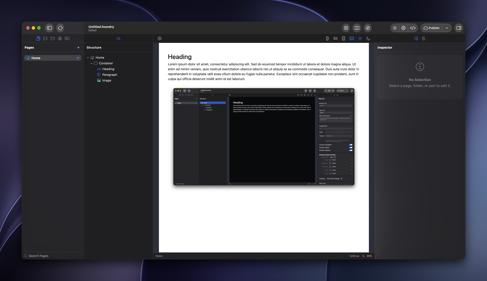

# Foundry



Foundry is a native macOS visual website builder. Arrange reusable parts on a
canvas, edit their content and responsive styling, and preview or publish the
resulting website. Generated sites use Bootstrap 6.

The editor combines SwiftUI, AppKit and WebKit. Projects are `.foundry` document
packages containing a structured site model, managed assets and installed part
packages.

## Development status

Foundry is under active development. Features, project formats and extension
APIs may change. Keep backups of important projects before opening them with a
development build.

Third-party licence clearance is still pending for CodeEditLanguages,
CodeEditSymbols and the GSAP Reveal integration. See
[the dependency notices](THIRD_PARTY_NOTICES.md) before publishing this checkout
or distributing app builds.

## Features

- Visual page editing with responsive layouts and a dockable workspace.
- Reusable and global parts, themes, templates and managed assets.
- Bootstrap-based styling with per-part HTML classes, CSS and attributes.
- Extensible parts supplied as validated `.foundrypack` and `.foundrydevpack` packages.
- Local HTML/PHP preview and static-site export.
- Publishing to local folders, FTP/FTPS, SCP/SFTP and S3.

## Build from source

### Requirements

- An Apple silicon Mac running macOS 27 or later.
- Xcode 27 with the macOS 27 SDK and command-line tools selected.
- Internet access for the initial Swift package resolution and PHP source download.

### Prepare the runtime

Clone this repository, then build the bundled PHP runtime from its root:

```sh
git clone https://github.com/doobox/Foundry.git
cd Foundry
./scripts/build-php-runtime
```

The script downloads checksum-verified PHP sources and stages the runtime in
`Foundry/PHPRuntime/`. This directory is deliberately excluded from Git. The
script also builds its pinned Bison prerequisite if a suitable version is not
available. Foundry uses this bundled runtime rather than a system or Homebrew
PHP installation. See [the PHP runtime notes](Runtime/PHP/README.md).

### Build the app

Open `Foundry.xcodeproj`, select the **Foundry** scheme and the **My Mac**
destination. Xcode resolves Swift package dependencies automatically. To run
through Xcode, select your own signing team in Signing & Capabilities; the
maintainer's configured team is not required for an unsigned build.

For an unsigned local build:

```sh
xcodebuild \
  -project Foundry.xcodeproj \
  -scheme Foundry \
  -destination 'platform=macOS' \
  -derivedDataPath .build/Foundry \
  CODE_SIGNING_ALLOWED=NO \
  build
```

This writes the app to `.build/Foundry/Build/Products/Debug/Foundry.app`.
Distributing a signed, notarised app requires your own signing credentials.

The publishing runtime's prebuilt library is included under
`Vendor/FoundryCurl/`; rebuilding it is only needed when changing that runtime.
See [its build notes](Vendor/FoundryCurl/README.md).

### Tests

Run tests with Product → Test in Xcode using the Foundry scheme. The repository
includes model, rendering, package-validation, publishing and UI-related tests.

Bootstrap's distributed CSS and JavaScript are already bundled. Node, npm and
Sass are not needed for an ordinary app build, preview or publishing. Framework
maintenance is documented in [tools/bootstrap/README.md](tools/bootstrap/README.md).

## Documentation

- [Architecture and source layout](ARCHITECTURE.md)
- [Part SDK tools](PartSDK/README.md)
- [Development fixtures](DevelopmentFixtures/README.md)
- [User guide and part developer documentation repository](https://github.com/doobox/foundry-docs)

The browsable documentation lives in a separate repository. Its local preview
helper expects that repository alongside this checkout; it is not required to
build the app.

## Contributing and security

See [CONTRIBUTING.md](CONTRIBUTING.md) for contribution guidance and
[SECURITY.md](SECURITY.md) for reporting vulnerabilities.

## Licence

Foundry's original code and documentation are licensed under the
[MIT licence](LICENSE). Commercial use and modified distributions are permitted
subject to its terms.

Bundled third-party code and resources retain their own licences. In particular,
GSAP uses its own standard licence with restrictions on certain visual animation
builders; it is not covered by Foundry's MIT licence. Review
[THIRD_PARTY_NOTICES.md](THIRD_PARTY_NOTICES.md) before redistributing the app or
its bundled libraries.

The MIT licence does not grant trademark rights or imply that a fork is an
official Foundry release.
